# 🚀 Library Project (Day 63)

A virtual bookshelf built with Flask and SQLite (SQLAlchemy), written while following the Udemy course "100 Days of Code: The Complete Python Pro Bootcamp". It is for course participants who want readable, runnable code with the assignment's names, and for visitors who want a small, tested Flask example.

## 📚 Table of Contents

- [Overview](#-overview)
- [Requirements](#-requirements)
- [Setup](#-setup)
- [Run](#-run)
- [Tests](#-tests)
- [License](#-license)
- [Links](#-links)
- [Appendix: Project documents](#-appendix-project-documents)

## 🧭 Overview

The project follows the lecture in four steps. Each step is a milestone with its own tests and a screenshot.

| Step | What it builds |
| --- | --- |
| 1 | A website that keeps books in an in-memory list (`all_books`) |
| 2 | The `sqlite3` lesson: a database file, a table and one record |
| 3 | The SQLAlchemy lesson: model, create, read, update and delete |
| 4 | The library website with a SQLite database: add, list, edit rating, delete |

The code is in `src/library_project/`, split in layers (`domain`, `application`, `infrastructure`, `presentation`), the tests are in `tests/`, and the project documents are in `docs/`. Constants are in `src/library_project/constants.py`. Source comments use Doxygen tags; `Doxyfile` generates the API documentation.

## 📋 Requirements

- Python 3.13 or newer, to run the code and the tests.
- `venv`, which comes with Python, to keep the packages of this project apart from your system.
- Flask and Flask-SQLAlchemy, the only runtime dependencies (installed by `pip`).
- Optional: Doxygen, only to generate the API documentation.

## 🛠️ Setup

Create and use a local virtual environment in `.venv`, upgrade `pip`, and install the project with the test tools.

Windows (PowerShell):

```powershell
python -m venv .venv
.venv\Scripts\Activate.ps1
python -m pip install --upgrade pip
python -m pip install -e ".[dev]"
```

macOS and Linux:

```bash
python3 -m venv .venv
source .venv/bin/activate
python -m pip install --upgrade pip
python -m pip install -e ".[dev]"
```

To leave the environment, run `deactivate`.

## ▶️ Run

Start a step from the project root with the environment active, then open <http://127.0.0.1:5000>.

### Step 1: books in an in-memory list

```bash
python -m library_project.main_in_memory
```

Add a few books, stop the server and start it again: the books are gone, because they only live in the list `all_books`. That is why the next steps add a database.

| Challenge | Screenshot |
| --- | --- |
| 1. Heading and "Add New Book" link | 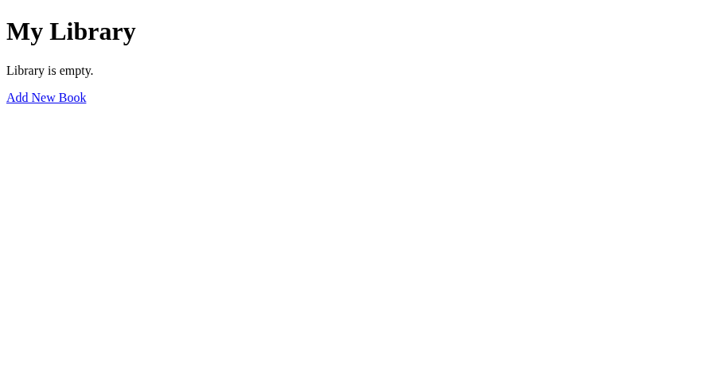 |
| 2. The `/add` form | 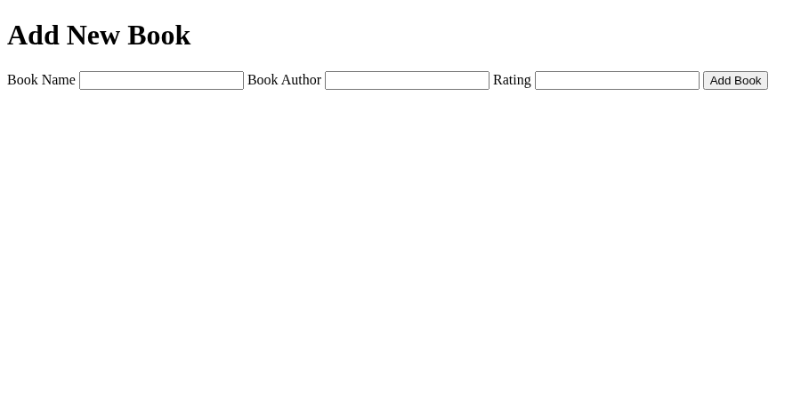 |
| 3. The form adds a dictionary to `all_books` | 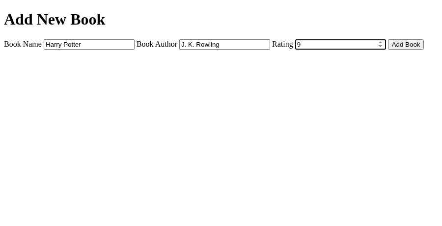 |
| 4. Books as `<li>` in a `<ul>` | 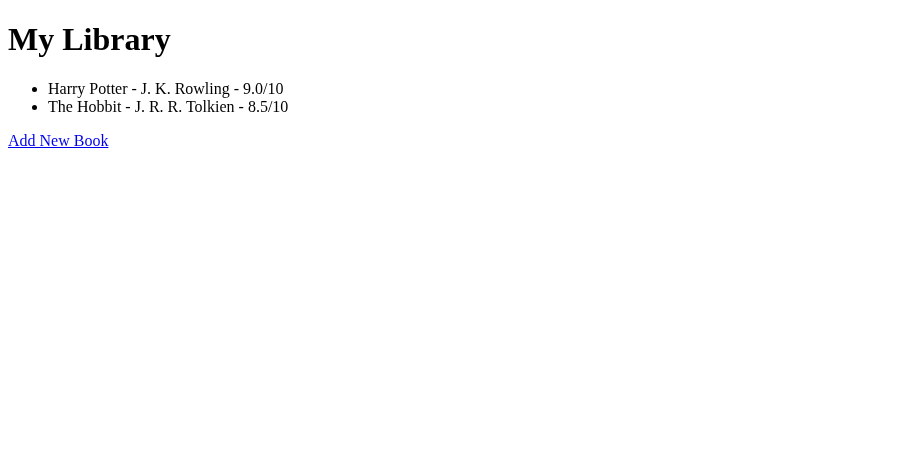 |
| 5. "Library is empty." message |  |

The screenshots are made by `bash scripts/screenshots/capture_screenshot.sh --all`, which runs a headless browser in a Docker container (never on your desktop).

### Step 2: the sqlite3 lesson

```bash
python -m library_project.infrastructure.lessons.sqlite3_lesson create
python -m library_project.infrastructure.lessons.sqlite3_lesson insert
python -m library_project.infrastructure.lessons.sqlite3_lesson show
```

This creates `books-collection.db`, the table `books` and the record "Harry Potter" with plain SQL. Every command can be run again without an error.

| Lesson step | Screenshot |
| --- | --- |
| Create the table `books` | 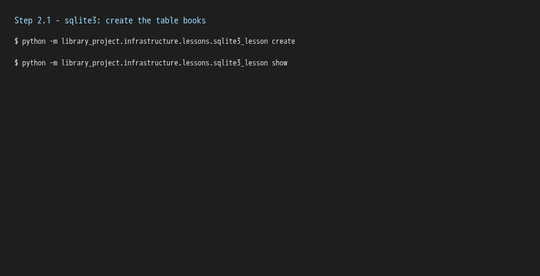 |
| Insert Harry Potter | 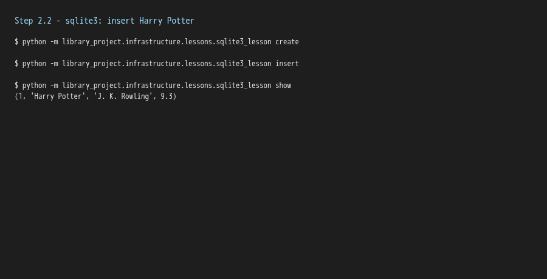 |

### Step 3: the SQLAlchemy lesson

```bash
python -m library_project.infrastructure.lessons.sqlalchemy_lesson create
python -m library_project.infrastructure.lessons.sqlalchemy_lesson read
python -m library_project.infrastructure.lessons.sqlalchemy_lesson update
python -m library_project.infrastructure.lessons.sqlalchemy_lesson delete
```

The same table is described as a Python class (`Book` in `infrastructure/sqlalchemy_models.py`) and the create, read, update and delete operations are written without SQL.

| Lesson step | Screenshot |
| --- | --- |
| Model, create table and first record | 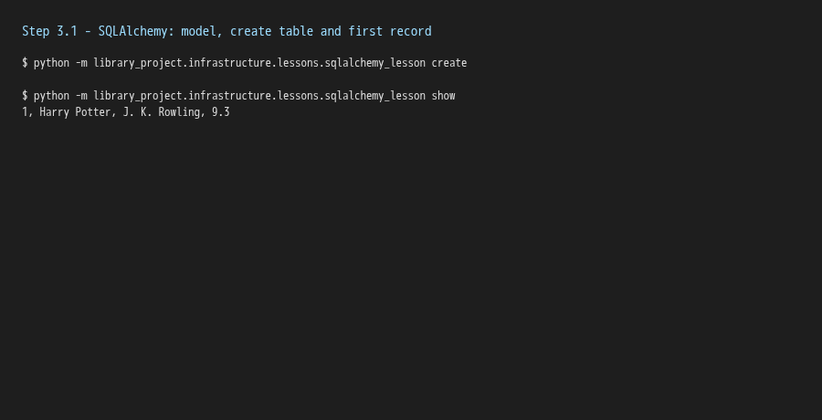 |
| Read all and read by title | 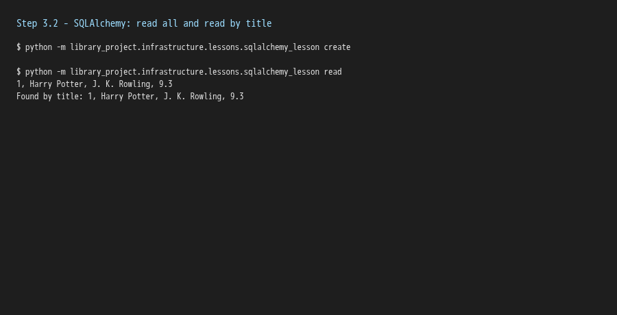 |
| Update by query and by primary key | 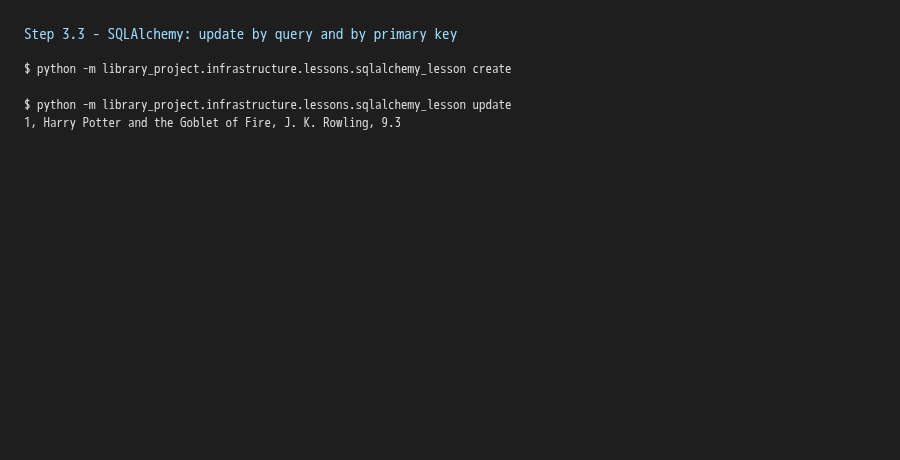 |
| Delete by primary key | 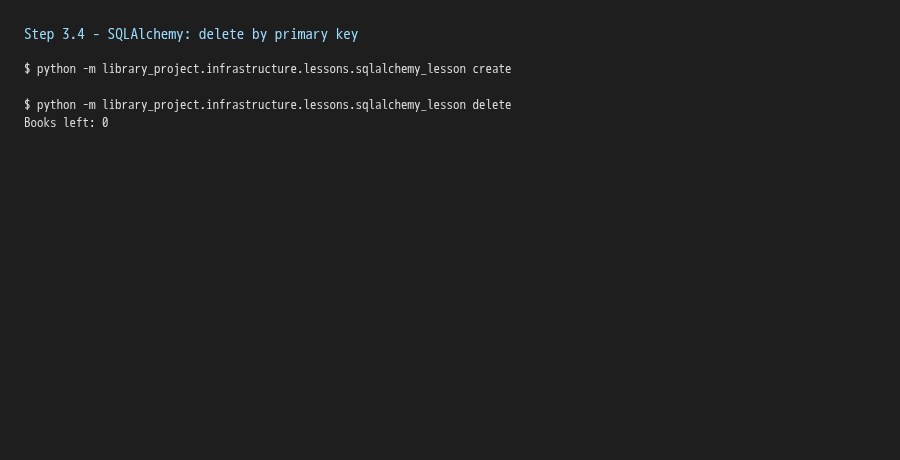 |

### Step 4: the library website with a database

```bash
python -m library_project.main
```

The books are now stored in `books-collection.db` (in the Flask `instance` folder), so they are still there after a restart. The home page lists every book with an **Edit Rating** link and a **Delete** link.

| Step | Screenshot |
| --- | --- |
| Add a book at `/add` | 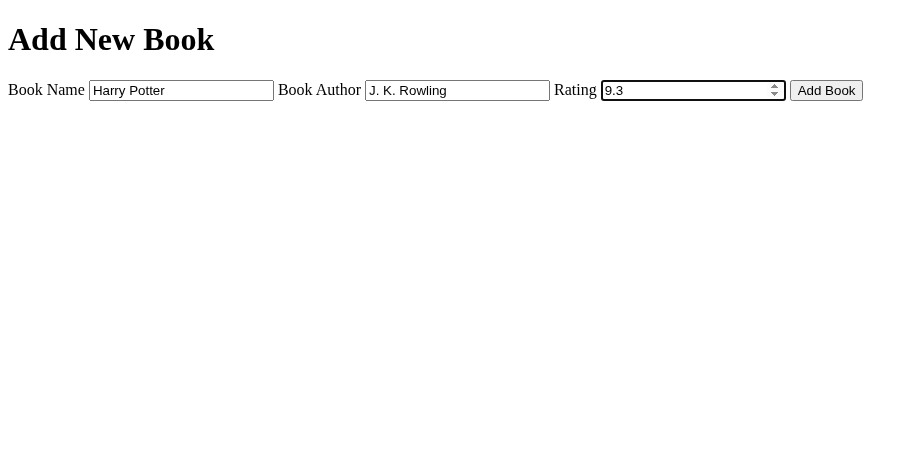 |
| The home page lists the books from the database |  |
| Edit the rating of one book | 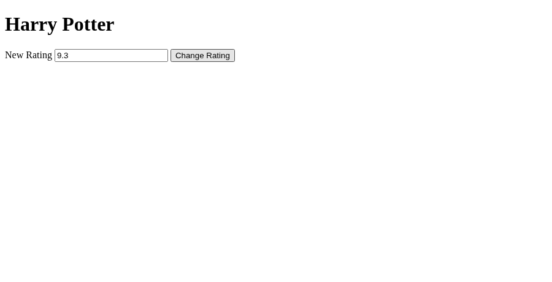 |
| The new rating is shown | 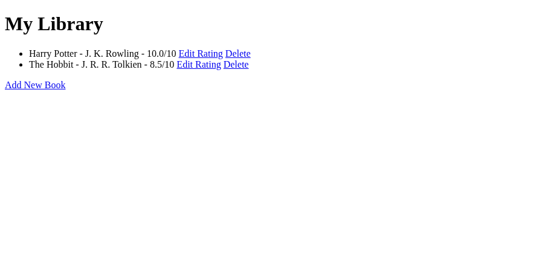 |
| Delete a book | 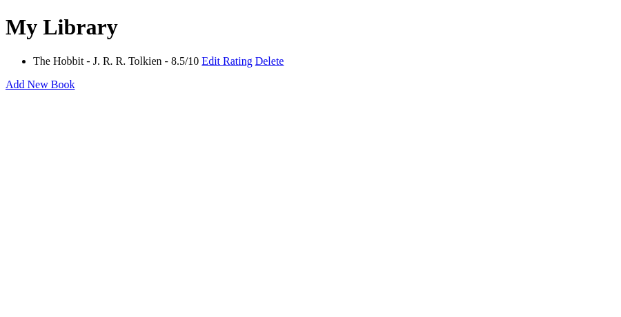 |

To generate the API documentation (optional):

```bash
doxygen Doxyfile
```

## 🧪 Tests

```bash
python -m pytest
```

Lint (optional):

```bash
python -m ruff check src tests
```

## 📄 License

GNU Affero General Public License v3, see [LICENSE][license].

## 🔗 Links

- [Repository][repository]
- [Documentation][documentation]
- [Issue tracker][issues]

## 📎 Appendix: Project documents

The documents a newcomer needs, in reading order.

| Document | What it tells you |
| --- | --- |
| [Business Case][BC-001] | Why the project exists, its scope and success criteria |
| [Stakeholder Analysis][SA-001] | Who is involved; the stakeholder IDs used for owners and reviewers |
| [Project Plan][PP-001] | The gateways and their schedule |
| [Milestones][milestones] | One document per gateway: Go/No-Go criteria and tasks |
| [Artifact registry][registry] | Where each artifact type lives, the next version, the PO language and domain |
| [Traceability matrix][TM-001] | How the artifacts link and when each was last reviewed |
| [Framework README][framework-readme] | The framework this project uses |
| [Framework changelog][framework-changelog] | What changed in each framework release |

---

[repository]: https://git.tirsystem.com/Tirsvad-Udemy-100-days-of-code/063-library-project
[documentation]: https://git.tirsystem.com/Tirsvad-Udemy-100-days-of-code/063-library-project/wiki
[issues]: https://git.tirsystem.com/Tirsvad-Udemy-100-days-of-code/063-library-project/issues
[license]: ./LICENSE
[BC-001]: ./docs/business-case.md
[SA-001]: ./docs/stakeholder-analysis.md
[PP-001]: ./docs/project-plan.md
[milestones]: ./docs/milestones/
[registry]: ./docs/artifact-registry.md
[TM-001]: ./docs/sqa/traceability-matrix.md
[framework-readme]: ./framework/README.md
[framework-changelog]: ./framework/CHANGELOG.md
