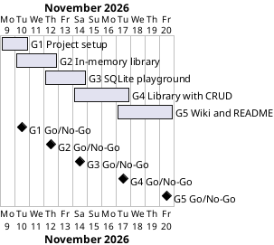

# Project Plan

## Metadata
| Key | Value |
| --- | --- |
| ID | PP-001 |
| CrossReference | [BC-001], [SA-001], [MIL-001], [MIL-002], [MIL-003], [MIL-004], [MIL-005] |
| Language | en |
| Domain | it |

## Version History
| Date | Status | Author | Reviewer | Change | Commit |
| --- | --- | --- | --- | --- | --- |
| 2026-11-09 | Accepted | Jens Tirsvad Nielsen | AI as stand-in for S01 | Initial version | [e02e021] |

---

## Purpose

This plan schedules the five phases (gateways) that deliver the Day 63 library project within the end date 2026-11-20 in [BC-001].

## Planning Assumptions

- Week 1 starts 2026-11-09; the plan ends by 2026-11-20, per the Business Case constraint.
- Phase length: one to three working days; each phase is one branch and one pull request.
- Communication follows [SA-001]: README per milestone, wiki in the last phase.
- Autonomous mode: the AI acts as stand-in reviewer for S01; each review record says so.
- Sources: the dates and phase split come from the user's request and the Business Case constraints [BC-001]; no baseline has been changed.
- Governance: S01 is owner, reviewer and approver of every gateway and is the only person who can move the end date. No separate governance document is kept for this lesson project (recorded in ADR-0001).

## Gateway Schedule

| Gateway | Document | Window | Decision date | Owner | Stories | Main deliverable | Milestone (not yet synced) |
| --- | --- | --- | --- | --- | --- | --- | --- |
| G1 Project setup | [MIL-001] | 2026-11-09 to 2026-11-10 | 2026-11-10 | S01 | none (technical tasks, ADR-0001) | pyproject, tooling, README skeleton, repository metadata | |
| G2 In-memory library | [MIL-002] | 2026-11-10 to 2026-11-12 | 2026-11-12 | S01 | none (technical tasks, ADR-0001) | Challenges 1 to 5 website with tests and screenshots | |
| G3 SQLite playground | [MIL-003] | 2026-11-12 to 2026-11-14 | 2026-11-14 | S01 | none (technical tasks, ADR-0001) | sqlite3 and SQLAlchemy lesson scripts with tests and screenshots | |
| G4 Library with CRUD | [MIL-004] | 2026-11-14 to 2026-11-17 | 2026-11-17 | S01 | none (technical tasks, ADR-0001) | Persistent website: add, list, edit rating, delete | |
| G5 Wiki and README | [MIL-005] | 2026-11-17 to 2026-11-20 | 2026-11-20 | S01 | none (technical tasks, ADR-0001) | Wiki in en, da, ms; final README | |



## Scope Coverage

| Business Case scope item | Gateway |
| --- | --- |
| Flask routes and templates (in-memory) | G2 |
| sqlite3 and SQLAlchemy playground scripts | G3 |
| Persistent CRUD website | G4 |
| pytest tests | G2, G3, G4 |
| README, screenshots | G1 (skeleton), G2 to G4 (per step), G5 (final) |
| Wiki en, da, ms | G5 |
| Repository description and topics | G1 |

## Dependencies

```
G1 → G2 → G3 → G4 → G5
```

A No-Go on a gateway stops the chain; later windows move by the rework time. S01 decides whether the end date 2026-11-20 moves.

## Plan Risks

| Risk | Impact | Mitigation |
| --- | --- | --- |
| Udemy files expire (from BC risk 1) | Templates rebuilt late | Rebuild from the lesson text in G2 |
| CI is not configured on the host | Pull requests have no checks to wait for | Run pytest and the framework check scripts locally before each PR; state it in the PR |
| Docker screenshots fail on Windows | Missing evidence | Stop and report; never use the host desktop |

## Open Issues

- Use cases and user stories are not modelled: the lesson steps are small and are tasks, not user goals worth a formal use case. ADR-0001 records this deferral (task in MIL-001).
- The target repository name: the request names `Tirsvad-Udemy-100_days_of_code`; the existing `origin` is `Tirsvad-Udemy-100-days-of-code/063-library-project`. The plan uses `origin`.
- No CI workflow exists yet; the plan treats local checks as the gate.

---

[BC-001]: ./business-case.md
[SA-001]: ./stakeholder-analysis.md
[MIL-001]: ./milestones/mil-001-project-setup.md
[MIL-002]: ./milestones/mil-002-in-memory-library.md
[MIL-003]: ./milestones/mil-003-sqlite-playground.md
[MIL-004]: ./milestones/mil-004-sqlalchemy-library-crud.md
[MIL-005]: ./milestones/mil-005-wiki-and-readme.md
[e02e021]: https://git.tirsystem.com/Tirsvad-Udemy-100-days-of-code/063-library-project/commit/e02e021cc1ba355061ecedf65df446c90006a8a6
