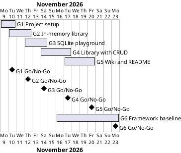

# Project Plan

## Metadata
| Key | Value |
| --- | --- |
| ID | PP-001 |
| CrossReference | [BC-001], [SA-001], [MIL-001], [MIL-002], [MIL-003], [MIL-004], [MIL-005], [MIL-006] |
| Language | en |
| Domain | education |

## Version History
| Date | Status | Author | Reviewer | Change | Commit |
| --- | --- | --- | --- | --- | --- |
| 2026-11-09 | Deprecated | Jens Tirsvad Nielsen | AI as stand-in for S01 | Initial version | [e02e021] |
| 2026-11-16 | Deprecated | Jens Tirsvad Nielsen | AI as stand-in for S01 | Added the baseline gateway G6 (MIL-006) with its schedule row, scope coverage, dependency, risk and Gantt entries; recorded the move of the end date, the domain, the open pull request #41, the tracked prompt log, the review record RC-016, the stale link of RC-009, the new traceability matrix rows and the CI in the Planning Assumptions and Open Issues; replaced the empty milestone column of G1 to G5 by the links to the milestones on the git host; set the domain to education; reviewed in autonomous mode, not independent | [351a3e9] |
| 2026-11-16 | Accepted | Jens Tirsvad Nielsen | AI as stand-in for S01 | Added task 7 and the scope for the fix of the OpenGrep findings that the shared check reported on the pull request (a behaviour-neutral change in three files); reviewed in autonomous mode, not independent | [75ef216] |

---

## Purpose

This plan schedules the five phases (gateways) that deliver the Day 63 library project within the end date 2026-11-20 in [BC-001] and, since the baseline gateway [MIL-006], a sixth phase that brings the finished project to the baseline of the framework and ends 2026-11-23.

## Planning Assumptions

- Week 1 starts 2026-11-09; the plan ends by 2026-11-20, per the Business Case constraint.
- Phase length: one to three working days; each phase is one branch and one pull request.
- Communication follows [SA-001]: README per milestone, wiki in the last phase.
- Autonomous mode: the AI acts as stand-in reviewer for S01; each review record says so.
- Sources: the dates and phase split come from the user's request and the Business Case constraints [BC-001]; no baseline has been changed.
- Governance: S01 is owner, reviewer and approver of every gateway and is the only person who can move the end date. No separate governance document is kept for this lesson project (recorded in ADR-0001).
- The baseline gateway G6 (MIL-006) starts 2026-11-16 and ends 2026-11-23, one week (source: [BC-001], Constraints). It brings the finished project to the baseline of the framework, a decision of S01. The decision dates of G1 to G5 stay as they were, so the end date of the plan moves from 2026-11-20 to 2026-11-23.
- For MIL-006 S01 has authorised the assistant to commit, push, open the pull request and merge it, and the review is done by an AI stand-in for S01 (source: [BC-001], Constraints and Risks).
- The PO language is English; the domain is IT until [MIL-006] and education since.

## Gateway Schedule

| Gateway | Document | Window | Decision date | Owner | Stories | Main deliverable | Milestone |
| --- | --- | --- | --- | --- | --- | --- | --- |
| G1 Project setup | [MIL-001] | 2026-11-09 to 2026-11-10 | 2026-11-10 | S01 | none (technical tasks, ADR-0001) | pyproject, tooling, README skeleton, repository metadata | [Milestone 402][ms-402] |
| G2 In-memory library | [MIL-002] | 2026-11-10 to 2026-11-12 | 2026-11-12 | S01 | none (technical tasks, ADR-0001) | Challenges 1 to 5 website with tests and screenshots | [Milestone 403][ms-403] |
| G3 SQLite playground | [MIL-003] | 2026-11-12 to 2026-11-14 | 2026-11-14 | S01 | none (technical tasks, ADR-0001) | sqlite3 and SQLAlchemy lesson scripts with tests and screenshots | [Milestone 404][ms-404] |
| G4 Library with CRUD | [MIL-004] | 2026-11-14 to 2026-11-17 | 2026-11-17 | S01 | none (technical tasks, ADR-0001) | Persistent website: add, list, edit rating, delete | [Milestone 405][ms-405] |
| G5 Wiki and README | [MIL-005] | 2026-11-17 to 2026-11-20 | 2026-11-20 | S01 | none (technical tasks, ADR-0001) | Wiki in en, da, ms; final README | [Milestone 406][ms-406] |
| G6 Framework baseline | [MIL-006] | 2026-11-16 to 2026-11-23 | 2026-11-23 | S01 | none (technical tasks, ADR-0001) | Branch `mil-006-framework-baseline` merged: the adopted framework release, the README, project URL metadata, `.editorconfig`, `.env.example`, the screenshot tool, the traceability matrix and review records | [Milestone 584][ms-584] |



## Scope Coverage

| Business Case scope item | Gateway |
| --- | --- |
| Flask routes and templates (in-memory) | G2 |
| sqlite3 and SQLAlchemy playground scripts | G3 |
| Persistent CRUD website | G4 |
| pytest tests | G2, G3, G4 |
| README, screenshots | G1 (skeleton), G2 to G4 (per step), G5 (final) |
| Wiki en, da, ms | G5 |
| Repository description and topics | G1 |
| The baseline: framework release, README, project URL metadata, editor settings, environment template, screenshot tool, traceability matrix, review records (objective O7) | G6 |

## Dependencies

```
G1 → G2 → G3 → G4 → G5 → G6
```

A No-Go on a gateway stops the chain; later windows move by the rework time. S01 decides whether the end date 2026-11-20 moves.

## Plan Risks

| Risk | Impact | Mitigation |
| --- | --- | --- |
| Udemy files expire (from BC risk 1) | Templates rebuilt late | Rebuild from the lesson text in G2 |
| CI is not configured on the host | Pull requests have no checks to wait for | Run pytest and the framework check scripts locally before each PR; state it in the PR |
| Docker screenshots fail on Windows | Missing evidence | Stop and report; never use the host desktop |
| A continuous integration (CI) check fails on the pull request of MIL-006 | The merge is delayed past 2026-11-23 | The failure is fixed on the same branch and the checks run again; after three failed rounds on one cause the work stops and S01 decides (trace: success criterion SC8 of [BC-001]) |

## Open Issues

- Use cases and user stories are not modelled: the lesson steps are small and are tasks, not user goals worth a formal use case. ADR-0001 records this deferral (task in MIL-001).
- The target repository name: the request names `Tirsvad-Udemy-100_days_of_code`; the existing `origin` is `Tirsvad-Udemy-100-days-of-code/063-library-project`. The plan uses `origin`.
- No CI workflow exists yet; the plan treats local checks as the gate.
- The point above describes G1 to G5. The pull request of MIL-006 is the first one that the shared CI checks of the git host run on; the project has no workflow file of its own.
- Domain: since [MIL-006] the plan, the Business Case and the baseline milestone have the domain `education`. The other documents (Stakeholder Analysis, milestones MIL-001 to MIL-005, the review records RC-001 to RC-016 and the decision records) keep the domain `it` or none they were accepted with; they are not changed by the baseline, and a change of their domain would need a new review of each.
- The git host also has the open pull request #41 (framework submodule URL in lowercase); the baseline delivers the same change in the pull request of MIL-006. The baseline does not close #41 on the host; S01 decides what happens to it after the merge.
- The repository is public and holds a tracked prompt log `docs/ai-prompts/session-001/prompts.md` from the planning session, although `.gitignore` lists `/docs/ai-prompts/`. MIL-006 leaves it untouched and keeps its own prompt log in a new, ignored session folder; S01 decides whether the tracked file stays.
- The review record RC-016 of the wiki has the verdict Go-with-conditions because its criterion 14 (published wiki) was Pending; MIL-006 reviews the wiki again against the current checklist, including the published wiki, in a new record and changes no page.
- The review record RC-009 used the link [SA-001] without a link definition; MIL-006 adds the definition and changes nothing else in it.
- The code carried `nosemgrep` markers from earlier milestones with a rule id (`opengrep.rules...`) that the shared ruleset no longer uses (`opengrep.selected-rules...`), so they did not suppress. The OpenGrep check of the pull request of MIL-006 reported 9 blocking findings: the five route functions in `presentation/web.py`, the SELECT statement in `infrastructure/lessons/sqlite3_lesson.py` and the sleep and two subprocess calls of `scripts/screenshots/capture_screenshot.py`. MIL-006 fixes them with behaviour-neutral changes (task 7) and adds no suppression; the markers of the fixed lines are removed. The markers of the remaining warnings (a plain HTTP call to the local test server in the screenshot script, the raw statements in the create and insert functions of the sqlite3 lesson) are left as they are.
- The framework has no quality checklist for the Traceability Matrix, so TM-001 is updated by MIL-006 but has no review record of its own; its Last Reviewed column names the records of the documents it lists.


---

[BC-001]: ./business-case.md
[SA-001]: ./stakeholder-analysis.md
[MIL-001]: ./milestones/mil-001-project-setup.md
[MIL-002]: ./milestones/mil-002-in-memory-library.md
[MIL-003]: ./milestones/mil-003-sqlite-playground.md
[MIL-004]: ./milestones/mil-004-sqlalchemy-library-crud.md
[MIL-005]: ./milestones/mil-005-wiki-and-readme.md
[e02e021]: https://git.tirsystem.com/Tirsvad-Udemy-100-days-of-code/063-library-project/commit/e02e021cc1ba355061ecedf65df446c90006a8a6
[ms-402]: https://git.tirsystem.com/Tirsvad-Udemy-100-days-of-code/063-library-project/milestone/402
[ms-403]: https://git.tirsystem.com/Tirsvad-Udemy-100-days-of-code/063-library-project/milestone/403
[ms-404]: https://git.tirsystem.com/Tirsvad-Udemy-100-days-of-code/063-library-project/milestone/404
[ms-405]: https://git.tirsystem.com/Tirsvad-Udemy-100-days-of-code/063-library-project/milestone/405
[ms-406]: https://git.tirsystem.com/Tirsvad-Udemy-100-days-of-code/063-library-project/milestone/406
[MIL-006]: ./milestones/mil-006-framework-baseline.md
[ms-584]: https://git.tirsystem.com/Tirsvad-Udemy-100-days-of-code/063-library-project/milestone/584
[351a3e9]: https://git.tirsystem.com/Tirsvad-Udemy-100-days-of-code/063-library-project/commit/351a3e9cd72ecaafcfc8ccd09c480433fae0c21a
[75ef216]: https://git.tirsystem.com/Tirsvad-Udemy-100-days-of-code/063-library-project/commit/75ef216785468b3a3a81602bc20864cd385accfb
